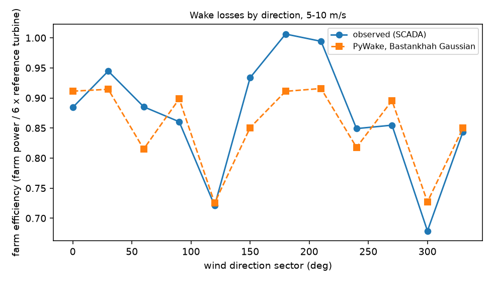
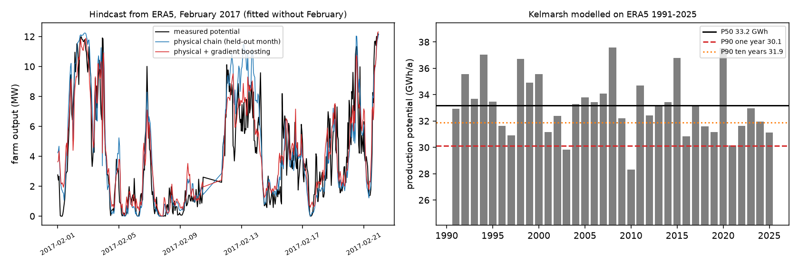
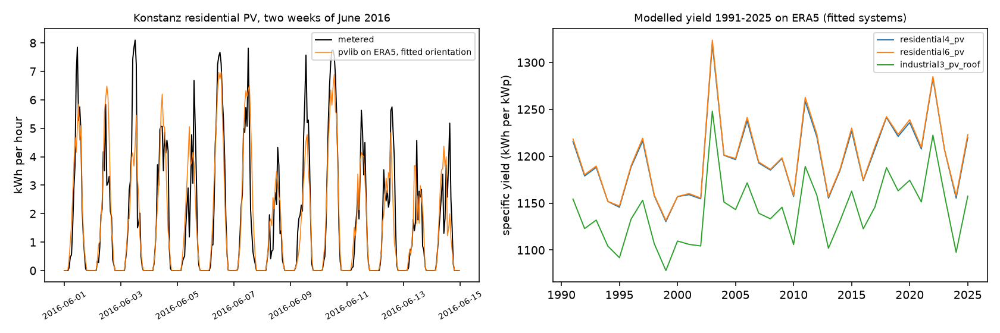

# Wind and solar asset models: from reanalysis weather to expected volume

[](https://github.com/michaelserikov/renewable-asset-yield/actions/workflows/tests.yml)

Physics-based production models of a real onshore wind farm and of metered rooftop PV systems, driven by ERA5
reanalysis and checked against measured production. The chain covers what a pricing or hedging desk needs from an
asset model: validated production history, power curves, wake losses, a weather-to-power model verified on held-out
data, a statistical correction on top of the physics, and long-term P50/P90 volumes with an explicit uncertainty
budget, stored with the hashes of the data and the code version that produced them.

- **Wind:** Kelmarsh wind farm (UK), 6 x Senvion MM92 (12.3 MW), ten-minute SCADA and the operator's event log for
  2017 (open data, Cubico Sustainable Investments, CC BY 4.0).
- **PV:** four metered rooftop systems in Konstanz, Germany, 2015-2018 (Open Power System Data), with unknown size
  and orientation.
- **Weather:** ERA5 hourly point series 1991-2025 at both sites.

## Results

**Data validation (WP0).** A rule-based filter that uses only the measurements (wind without power, power well
below the turbine's own curve with pitched blades, missing and frozen signals) flags 2.0% of the 10-minute records
and captures 96% of the 576 MWh the operator books as lost to downtime. It finds 71% of the records inside logged
stops; the rest are logged stops in low wind, where nothing is lost. For the PV meters the time stamps had to be
checked first: read as interval start, all four systems produced 0.3 to 1.1 hours before solar noon in summer and
in winter alike, which no orientation explains; the readings are end-of-interval values.

**Power curves (WP1).** Density-normalised method-of-bins curves from clean data; the six turbines differ by 2.3%
(mean coefficient of variation of power at 5-11 m/s).

**Wakes (WP2).** Farm efficiency by wind direction at 5-10 m/s, measured against a fixed upwind reference turbine,
and modelled with PyWake (Bastankhah Gaussian deficit) on the real layout, hub heights (two turbines stand 10 m lower)
and the fitted power curve: 12.8% measured against 14.7% modelled, sector pattern correlation 0.85, worst sector
300 degrees (68% vs 73% efficiency). Using the record-wise best turbine as reference instead inflates the measured
loss to 23%: the largest of six noisy readings is not the free stream.



**Weather to power, verified on held-out months (WP3).** ERA5 100 m wind, the hour's own shear and air density,
one speed factor k for the ERA5 bias at the site, the fitted power curves at each hub height and PyWake for the
hour's direction. Each month is predicted by a model fitted on the other eleven:

| | hourly MAE (% of capacity) | hourly RMSE | hourly correlation | monthly energy error |
|---|---|---|---|---|
| physical chain | 8.3% | 12.1% | 0.91 | 5.5% |
| physical chain + gradient boosting on its residual | 7.7% | 10.8% | 0.92 | 3.6% |

The speed factor is 0.949 with a spread of 0.002 across the twelve fits: ERA5 overstates the wind at this site by
about 5%, consistently.

**Long-term volume, P50/P90 (WP4).** The model fitted on 2017 runs on 35 years of ERA5:

| | value |
|---|---|
| P50 production potential | 33.2 GWh/a (capacity factor 30.8%) |
| interannual variability | 6.8% (lowest year 2010: 28.3 GWh, highest 2008: 37.6 GWh) |
| uncertainty budget besides weather | calibration 1.3%, measurement 1.0%, choice of period 1.4% |
| P90, one year / ten years | 30.1 / 31.9 GWh (91% / 96% of P50) |
| long-term wake loss | 10.0% |
| 2017 | an average year (rank 17 of 35, +0.1% vs P50) |
| trend | -0.17% per year, within the variability |

Monthly P50 and P90 volumes for hedging are in `results/wp4_monthly_volume_gwh.csv`.



**PV (WP5).** pvlib chain (Erbs decomposition, Perez transposition, Faiman cell temperature, PVWatts with
-0.4%/K) on ERA5, with DC size, tilt and azimuth fitted on the first year and verified on the rest. Hourly
correlation 0.92 to 0.95, daily 0.93 to 0.95, held-out energy within 4% to 10%. The checks separate outage days
(1% to 4% of energy) and snow-like winter days (1% to 6%) from the production potential. Long-term specific yield
of the reference system: P50 1,198 kWh/kWp (1991-2025), interannual variability 3.4%, P90 at 92% (one year) and 94%
(ten years) of P50. ERA5 shows the last decade 3.6% sunnier than the 1990s, so the averaging period alone moves the
P50 by 1.4%.



**Software (WP6).** A Python package (`src/assetyield`) with tests and continuous integration. Each estimate is
stored in `results/estimates/` with SHA-256 hashes of its input files, the git commit and the parameters;
`registry.verify()` reports whether the data on disk still match.

## Limitations

One measured year for the wind farm; one site, onshore, in the UK; the thrust curve is a generic one for the size
class (the MM92 thrust curve is not public); no curtailment in the 2017 data, so curtailment detection is tested
only on derating; ERA5 reanalysis is a hindcast, not a historical forecast, so this is not a forecast verification;
the PV systems are small rooftop systems with unknown metadata; the uncertainty budget is simplified (normal
components, no correlation between them).

## Run it

```
python -m venv .venv && .venv/Scripts/activate
pip install -e ".[test]"
pytest -q
python scripts/prepare_data.py       # only to rebuild data/raw from the downloads
python scripts/wp12_curves_wakes.py  # WP0-WP2 (PYTHONPATH=src)
python scripts/wp34_longterm.py      # WP3-WP4
python scripts/wp5_pv.py             # WP5
```

## Data

| Data | Source | Licence |
|---|---|---|
| Kelmarsh SCADA and event log 2017, turbine data | Plumley (2022), Zenodo 10.5281/zenodo.5841834 | CC BY 4.0 |
| ERA5 hourly point series 1991-2025 | Copernicus Climate Change Service, Climate Data Store | Copernicus licence |
| Household and business PV meters, Konstanz | Open Power System Data, household data package | CC BY 4.0 |
